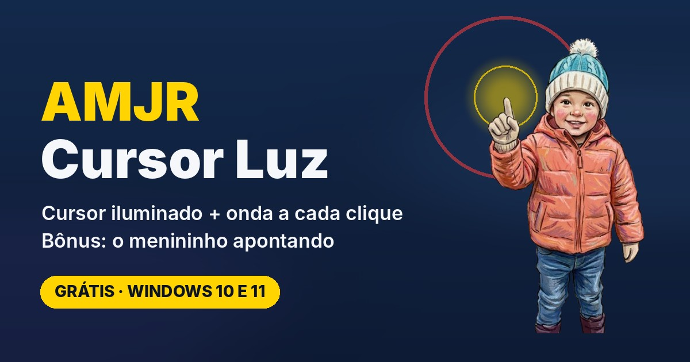
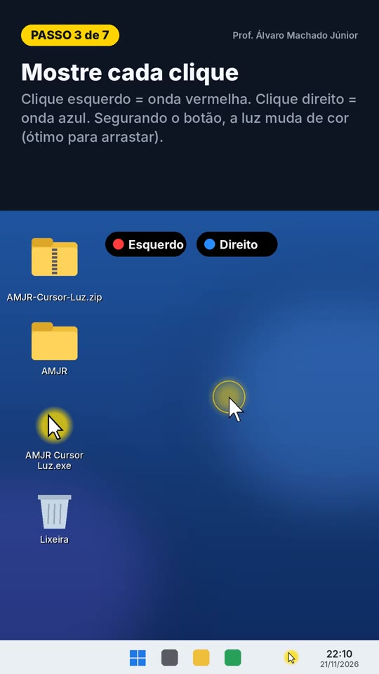
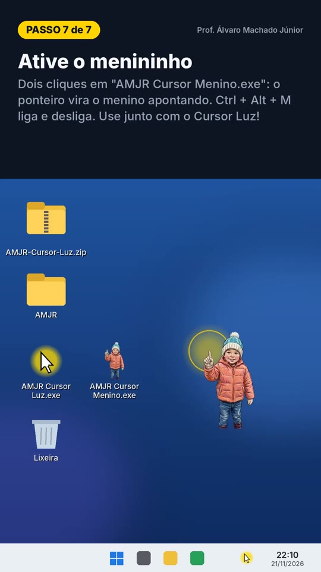

# AMJR Cursor Luz

**Cursor iluminado e cliques visíveis para aulas, projetor e vídeos — gratuito e para fins educacionais.**
*A highlighted mouse pointer with visible clicks for classes, projectors and screen recordings — free and educational.* ([English below](#english))

O pacote traz dois programas pequenos para Windows:

- **AMJR Cursor Luz**: coloca uma luz em volta do ponteiro e mostra uma onda a cada clique (vermelha no botão esquerdo, azul no direito). Ótimo para os alunos acompanharem no projetor e para gravar tutoriais e Reels.
- **AMJR Cursor Menino** (bônus): troca o ponteiro do Windows por um menino apontando com o dedo, animado ou parado.

**Prof. Álvaro Machado Júnior** · Professor de Informática, Tecnologia Educacional e IA
🌐 [prof.alvaromjunior.com/cursor-luz](https://prof.alvaromjunior.com/cursor-luz) (com vídeo do passo a passo)

| Cliques visíveis | O menininho |
|---|---|
|  |  |

---

## ⬇️ Como baixar e usar

1. Baixe o **`AMJR-Cursor-Luz.zip`** pelo [**meu site**](https://prof.alvaromjunior.com/cursor-luz) ou na página [**Releases**](https://github.com/profalvaromjunior/amjr-cursor-luz/releases/latest).
2. Clique com o botão direito no arquivo e escolha **Extrair tudo**. Use uma pasta **fora** de Imagens, Documentos e Área de Trabalho (por exemplo `C:\AMJR`), porque o *Acesso controlado a pastas* do Windows pode bloquear essas pastas.
3. Abra **`AMJR Cursor Luz.exe`**. Se aparecer **"O Windows protegeu o computador"**, clique em **Mais informações › Executar assim mesmo** (o programa é novo e ainda não tem assinatura digital).
4. Pronto: o cursor ganha luz. Configure tudo no ícone perto do relógio (botão direito).
5. Bônus: abra **`AMJR Cursor Menino.exe`** para o ponteiro virar o menino. Ao sair, o ponteiro normal do Windows volta.

**Requisitos:** Windows 10 ou 11. Não precisa instalar nada.

## ⌨️ Atalhos e opções

| | AMJR Cursor Luz | AMJR Cursor Menino |
|---|---|---|
| **Liga/desliga** | `Ctrl + Alt + L` | `Ctrl + Alt + M` |
| **Menu do ícone** | Cor da luz, Tamanho (até *Máximo*, para o cursor grande do Windows), Intensidade, Mostrar cliques, Iniciar com o Windows | Animado ou parado, Tamanho, Usar também nos links, Iniciar com o Windows |
| **Ao sair** | A luz some | O ponteiro original do Windows volta |

💡 **Dica para o projetor:** em *Configurações › Acessibilidade › Ponteiro do mouse*, deixe o **Tamanho** no máximo e escolha **Tamanho › Máximo** no Cursor Luz.

## 🛠️ Compilar você mesmo

O código é C# simples (Windows Forms) e compila com o compilador que **já vem no Windows**, sem instalar nada. Em cada pasta (`cursor-luz` e `cursor-menino`) há um **`Compilar.bat`**: dois cliques e ele gera o `.exe` numa pasta temporária, copia de volta e abre o programa.

O pacote da página Releases é compilado pelo **GitHub Actions** a partir deste código (veja `.github/workflows/build.yml`).

## 🤖 Como eu desenvolvi

Criei tudo conversando com o **Claude** (Anthropic), em português: pedi um ponteiro iluminado para as aulas, depois a animação de clique, o menu na bandeja, os tamanhos maiores para o projetor e o cursor do menino. O desenho do menino eu gerei com IA e o Claude transformou em cursor do Windows (`.cur` e `.ani` animado). Os erros que apareceram nos testes (OneDrive, *Acesso controlado a pastas*, arquivo em uso) viraram melhorias no `Compilar.bat`.

## 📄 Licença

Código sob a licença [MIT](LICENSE). Uso gratuito e educacional, fornecido "como está", sem garantias.

---

## English

**AMJR Cursor Luz** adds a glow around the mouse pointer and a ripple on every click (red = left, blue = right), so students can follow along on a projector and viewers can follow screen recordings. The bonus **AMJR Cursor Menino** replaces the Windows pointer with an animated boy pointing his finger.

- Download `AMJR-Cursor-Luz.zip` from [Releases](https://github.com/profalvaromjunior/amjr-cursor-luz/releases/latest), extract it outside Pictures/Documents/Desktop (e.g. `C:\AMJR`) and run the `.exe` files. If SmartScreen warns you, click *More info › Run anyway*.
- Toggle: `Ctrl + Alt + L` (light) and `Ctrl + Alt + M` (boy cursor). Everything else is in the tray icon menu.
- Windows 10/11, portable, no install. Plain C# that builds with the compiler that ships with Windows (`Compilar.bat`).
- Built with **Claude** (Anthropic) by Prof. Álvaro Machado Júnior. MIT license.
